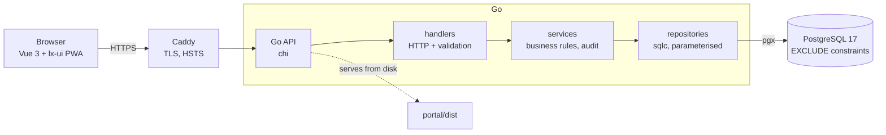

<div align="center">

# 🚌 Bus Fleet & Trip Planning

**Plan trips. Assign a bus and a driver. See the whole day on a timeline.**

An internal system for a passenger bus company, built secure by default
and ready for payroll without a schema rewrite.


[Features](#-features) ·
[Architecture](#-architecture) ·
[Security](#-security--privacy) ·
[Quick start](#-quick-start) ·
[Development](#-development) ·
[Project layout](#-project-layout)

</div>

---

## ✨ Features

| | |
|---|---|
| 🗓️ **Timeline** | Day, week and month views; multi-day trips render as one spanning bar. |
| 🚍 **Trips & assignments** | One bus and one driver per trip, with a clear message naming the trip that blocks a clash. |
| 🔁 **Trip series** | Weekly recurrence generates plain trips; edit *this one* or *this and all future*. |
| 🧾 **Clients & billing** | Clients, invoice numbers and a payment status per trip (planner-only). |
| 📱 **Driver view** | Drivers see only their own trips and start/finish them from a phone. Installable PWA. |
| 📊 **Statistics** | Trip volume over time for admins. |
| 🌍 **Three languages** | English, Latvian, Russian; the choice survives a reload. |
| 🛡️ **Roles** | `admin`, `dispatcher`, `driver`, each enforced on the server. |
| ⏱️ **Payroll-ready** | Worked time is recorded per trip and tied to a driver, so payroll needs no migration. |

## 🏗️ Architecture



- **Layered Go API.** `handler → service → repository`: handlers do HTTP only, services
  own the rules, and all SQL goes through `sqlc`, so queries are compile-checked and
  injection is impossible by construction.
- **Illegal states are unrepresentable.** A bus and a driver can't be on two trips that
  overlap: a Postgres `EXCLUDE USING gist` constraint enforces it, and the service layer
  re-checks it to return a friendly error. Statuses and roles are database enums.
- **One frontend.** The Vue 3 + [lx-ui](https://github.com/dativa-lv/lx-ui) portal talks
  to the JSON API only. See [docs/lx-ui-integration.md](docs/lx-ui-integration.md).

## 🔒 Security & privacy

| Area | What is in place |
|---|---|
| Authentication | argon2id hashing, opaque server-side sessions in `HttpOnly` `__Host-` cookies, rotation on login, idle and absolute expiry, logout invalidates server-side |
| Request safety | CSRF token on every state-changing request, nonce-based CSP, security headers, request size limits |
| Abuse control | Login limited per IP **and** per account, a sane global limit |
| Authorization | Role checks on every route on the server; a driver reaches only their own data, verified by the session, never by a client-supplied id |
| Database | Least-privilege `fleet_app` role (no DDL); migrations run as a separate `fleet_owner`; append-only audit log |
| Audit | Every mutation records who, what, when, before and after; entries are purged after two years |
| GDPR | Admin erasure anonymises personal data without breaking history; EU-only hosting; encrypted `age` backups |
| Supply chain | Images pinned by digest, distroless non-root runtime, `gosec`, `govulncheck` and `npm audit` in CI |

## 🚀 Quick start

```sh
cp .env.example .env
# Fill in every empty value. Generate each secret with: openssl rand -hex 32
docker compose up --build
bash scripts/create-admin.sh      # dev only: creates the first admin from .env
```

Then open `https://$APP_DOMAIN/app/`. The stack refuses to start while a secret is empty,
and the app rejects a placeholder `APP_SECRET`.

## 🧑‍💻 Development

```sh
make test          # unit + integration tests on a throwaway Postgres (needs Docker)
make test-unit     # unit tests only; database-backed tests are SKIPPED
make vet fmt-check # static checks
make vuln          # govulncheck
make generate      # regenerate sqlc code (runs from its Docker image)
make hooks         # git hooks: gofmt, vet and gosec before commit/push
make portal-test   # portal unit tests
make verify-e2e    # Playwright against the running stack
```

Portal: `cd portal && npm ci && npm run dev` (proxies `/api` to `localhost:8080`), and
`npm run lint`. npm is the package manager, deliberately.

### Tests

| Layer | Tooling | Covers |
|---|---|---|
| Unit | Go `testing` | domain rules, validation, status transitions, config |
| Integration | Go + real PostgreSQL | conflict detection, role boundaries, CSRF on every route, audit, erasure |
| Portal | Vitest | date handling, router, error mapping |
| End to end | Playwright through Caddy (TLS) | login, every page, forms, timeline, PWA and offline behaviour |

CI runs all of it, plus `gofmt`, `go vet`, `-race`, ESLint, `gosec`, `govulncheck`, an
`npm audit` and a production image build.

## 🗂️ Project layout

```
cmd/server           the binary: HTTP server plus the create-admin subcommand
internal/domain      entities, roles, statuses, transition rules (no I/O)
internal/service     business logic, validation, audit recording
internal/repo        sqlc-generated queries and the transaction helper
internal/httpapi     routes, middleware and the JSON API handlers
internal/auth        sessions, password hashing, CSRF
internal/inttest     integration tests against real Postgres
db/migrations        paired, reversible up/down migrations (queries in db/queries)
portal/              Vue 3 + lx-ui app, its PWA worker and Playwright e2e
deploy/              Postgres role init and the encrypted-backup service
scripts/             verification, admin creation and git hooks
```

## 🛠️ Operations

- **Backups.** `pg_dump` encrypted with `age`; restore verified by
  `scripts/verify-backup.sh`. See [deploy/backup/README.md](deploy/backup/README.md).
  The off-site destination is not configured yet.
- **Rules of the project.** Security baseline, GDPR baseline and the definition of done
  live in [CLAUDE.md](CLAUDE.md).
